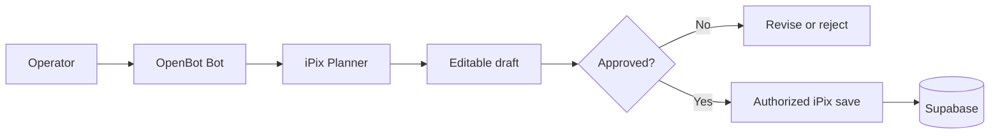

# Mermaid Diagrams — iPix → OpenBot

**Source — ADAPT:** https://github.com/amoai-tech/ipixai/blob/13bf2af385ebbe68a78c652daf5cffa3db95df24/.agents/skills/mermaid-diagrams/SKILL.md

## OpenBot boundaries
- Inspect the current Bun monorepo, installed packages and relevant existing OpenBot code first. Do not copy iPix Next.js routes, paths, transport, environment secrets, or deployment assumptions.
- Keep `openbot-copy`, `openbot-data-access`, and `openbot-screen-layout` authoritative for user-facing copy, browser API operations and configuration-screen layout.
- iPix owns domain data in Supabase and its Mastra Planner; OpenBot connects through its supported authenticated agent/API interfaces.
- Never trust a browser-supplied organization, user, thread or run ID as authorization. Human approval plus server-side revalidation and idempotent execution are mandatory for consequential actions.

## Diagram rule
Select flowchart for responsibilities, sequence for cross-service calls, state for approval, and dependencies for delivery. Include trusted server boundary, human approval and failure/recovery where relevant. Label proposals as proposed; never invent endpoints. Render/validate Mermaid syntax when tooling is available.
## Example

## Verify
Diagram matches current repository, API ownership and real approval behavior.
