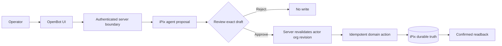

# Mermaid Diagrams — defect discovery, not decoration

**Source — ADAPT:** https://github.com/amoai-tech/ipixai/tree/main/.agents/skills/mermaid-diagrams

Use the **one smallest useful diagram** for a substantial task. Add another only for a distinct material risk; otherwise record `Diagram: N/A — no meaningful relationship/state/sequence to model.`

## Choose the diagram

- `flowchart`: journey, responsibilities, decisions and fallback.
- `sequenceDiagram`: browser → OpenBot → external iPix agent/API → storage calls, order and failures.
- `stateDiagram-v2`: proposal, review, reject, approval, resume and expiry.
- `erDiagram`: real verified data relationships and ownership.
- `journey`: operator experience, not authorization proof.
- Advanced/beta types only when supported by the target renderer.

## Verify before drawing

1. Inspect OpenBot's actual Bun/React routes, shared API contract, harness and agent integration; consult iPix files only for iPix-owned behavior.
2. Label **current**, **proposed** and **unverified** nodes distinctly. Do not invent a Supabase write route, CopilotKit/Mastra API or deployment.
3. Model trusted server authorization of organization, resource and actor. A browser ID or agent output is not authority.
4. For consequential actions draw **proposal → human review → server validation of exact approved artifact/revision → idempotent write → durable readback**.
5. Show rejection, timeout, duplicate/retry, ownership and recoverability where material.
6. Inspect diagram for red flags: missing owner, duplicate source of truth, client-trusted tenant, hidden side effect, bypassed approval, unsafe retry, unhandled provider failure and absent proof.
7. Render/parse against the target Mermaid version when available. Diagrams are hypotheses; tests/runtime logs establish actual behavior.

## Example — proposed cross-service approval path

## Readability, accessibility and security

- Keep labels short, name real services and decisions, and use meaningful edge labels.
- Use `accTitle` / `accDescr` where the renderer supports them; accompany visuals with a plain-text conclusion.
- Never embed secrets, customer data, tokens or private endpoints. Do not relax Mermaid renderer security to enable HTML/interactivity.
- Beware reserved lowercase `end`, special characters and syntax that differs across renderer versions.

Official references:
- [Mermaid syntax](https://mermaid.js.org/intro/syntax-reference)
- [Flowcharts](https://mermaid.js.org/syntax/flowchart)
- [Sequence](https://mermaid.js.org/syntax/sequenceDiagram)
- [Accessibility](https://mermaid.js.org/config/accessibility)

**Verify:** The diagram matches observed code/runtime, shows consequential failure paths, and parses on the target renderer.
