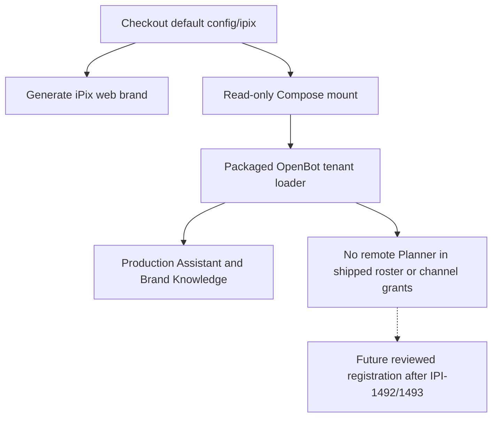

# iPix application configuration

This is the main iPix web application package, adapted from the pinned OpenBot
Fintech example. Upstream examples remain unchanged for upgrades and comparison.

- Fresh checkout: copy .env.example to .env and follow the existing startup
  instructions. The frontend generator and build cache default to this package.
- Compose: the checkout's standard docker-compose.yml mounts this directory
  read-only at /app/config/ipix and selects it by default. Customer-owned
  Compose overrides remain separate and protected by the updater. Explicit
  TENANT_PACKAGE_DIR selections (including Desktop's personal package) still win.
  Desktop distributions that do not carry the checkout can mount an empty
  directory; the selected bundled personal package is unaffected. The iPix
  package itself must contain the five required, readable, nonempty YAML files;
  the Compose entrypoint refuses an incomplete selection before starting the server.
  The updater may replace the clean, fully tracked default package; local modifications,
  extra files (even ignored ones), explicit protected paths and custom packages retain
  customer protection.
- Existing installations: keep your backup, review existing seeded Bots and
  grants, then explicitly change TENANT_PACKAGE_DIR=../config/ipix in .env and
  restart/rebuild the checkout web app. The stable package ID remains openbot.
  The loader may preserve user edits or retire old seed entries; verify actual
  conversations, Bot grants and channels before switching real workspaces.
  Do not reset volumes or change deployment/installation IDs.
- The packaged server's bundled web assets are upstream; run the checkout's
  web frontend (scripts/start.sh) for generated iPix branding. A custom release
  image is a separate deployment task.
- No real brand data, management MCP access or production writes are enabled
  by this package. The Mastra Planner is intentionally absent from the server's
  active agent roster and channel grants. The Compose server receives .env via
  env_file, but Planner variables cannot activate an agent that is not declared.
  IPI-1492 and IPI-1493 must prove per-user identity, tenant isolation and exact
  agent discovery before a reviewed code change registers the Planner. Do not
  manually register it or reuse an earlier pilot roster with real brand data.
  Existing pilot installations must verify and remove any previously registered
  Planner and its grants before allowing user access; this package does not
  certify cleanup of existing database state.
- Neither default coworker is granted bot-creator or skill-creator. Their definitions
  are retained for explicit authorized operator grants; ordinary fashion conversations
  do not offer authoring tools. The native slash menu lists granted skills only;
  the skill catalog summaries explain the required operator grant. Existing
  user-edited grants must be checked separately.
  OpenBot's own user permissions and human confirmation still govern actual writes.
- Knowledge YAML is validated metadata, not a connected data source. Google Drive
  and Notion require the person's authorized Connections and applicable Bot grants.
  OneDrive is not supported by the pinned server; no ingestion is promised.
- The model and built-in skill instructions retain the upstream supported
  schema; verify the configured credential can access the model at runtime.
- Rollback: restore the previous TENANT_PACKAGE_DIR and rebuild/restart the
  frontend and server. Use the verified backup for state restoration only if
  necessary; never delete existing volumes to switch packages.

Source: https://github.com/CopilotKit/OpenBot/tree/v1.1.2/examples/fintech
(ADAPT: configuration structure, general skills, seeded IDs; not finance roles
or grants). Loader reference:
https://github.com/CopilotKit/OpenBot/blob/v1.1.2/docs/configuration.md#tenant-package

