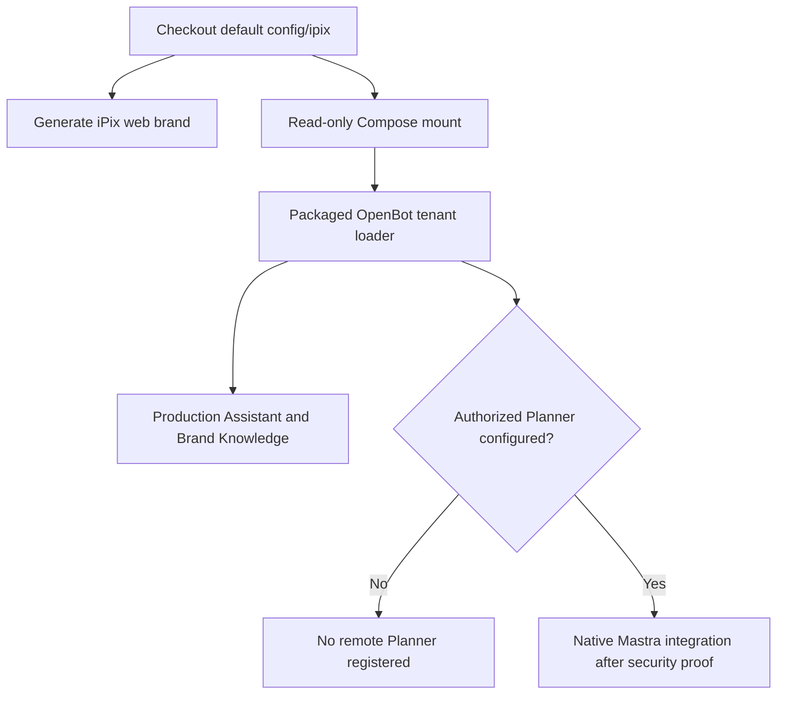

# iPix application configuration

This is the main iPix web application package, adapted from the pinned OpenBot
Fintech example. Upstream examples remain unchanged for upgrades and comparison.

- Fresh checkout: copy .env.example to .env and follow the existing startup
  instructions. The frontend generator and build cache default to this package.
- Compose: the checkout's docker-compose.override.yml mounts this directory
  read-only at /app/config/ipix and selects it by default. If invoking Compose
  with explicit -f options, include both docker-compose.yml and
  docker-compose.override.yml. The standalone upstream image/Desktop layout
  without that override retains its original packages.
- Existing installations: keep your backup, review existing seeded Bots and
  grants, then explicitly change TENANT_PACKAGE_DIR=../config/ipix in .env and
  restart/rebuild the checkout web app. The stable package ID remains openbot.
  The loader may preserve user edits or retire old seed entries; verify actual
  conversations, Bot grants and channels before switching real workspaces.
  Do not reset volumes or change deployment/installation IDs.
- The packaged server's bundled web assets are upstream; run the checkout's
  web frontend (scripts/start.sh) for generated iPix branding. A custom release
  image is a separate deployment task.
- No real brand data, management MCP access or production writes are enabled
  by this package. The optional native Planner endpoint is blank by default
  until IPI-1492 and IPI-1493 prove authorization and migration.
- Rollback: restore the previous TENANT_PACKAGE_DIR and rebuild/restart the
  frontend and server. Use the verified backup for state restoration only if
  necessary; never delete existing volumes to switch packages.

Source: https://github.com/CopilotKit/OpenBot/tree/v1.1.2/examples/fintech
(ADAPT: configuration structure, general skills, seeded IDs; not finance roles
or grants). Loader reference:
https://github.com/CopilotKit/OpenBot/blob/v1.1.2/docs/configuration.md#tenant-package

