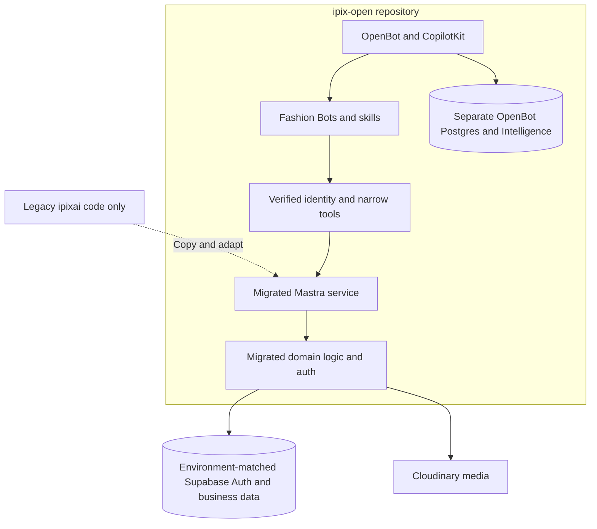
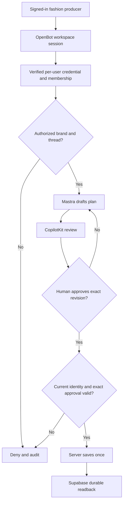
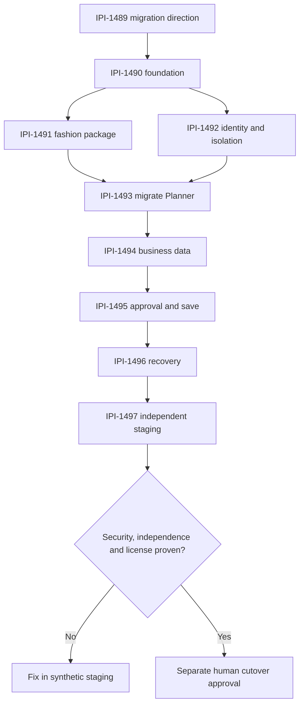

# iPix Open ADR 001 — Migrate iPix into OpenBot

**Status:** Owner-directed migration into ipix-open. Development and synthetic verification first; exact-head merge, live customer data and production cutover remain separate gates.
**Date:** 2026-11-23
**Task:** [IPI-1489](https://linear.app/amo100/issue/IPI-1489)
**Canonical application:** https://github.com/amoai-tech/ipix-open
**Legacy migration source only:** https://github.com/amoai-tech/ipixai
**Source baselines:** legacy 13bf2af385ebbe68a78c652daf5cffa3db95df24; OpenBot v1.1.2 8826a0fe3827b80c519b6b8a274e74efbaef7868. Revalidate before each migration.

## Version decision update — 2026-11-26

Owner requested v1.2.0 as the next development foundation. The prior v1.1.2 deployment remains unchanged until the upgrade is reviewed and its synthetic runtime and rollback gates pass. See [v1.2.0 upgrade](../openbot-v1.2.0-upgrade.md) for the exact source, permission and migration gates. This supersedes the earlier v1.1.3 candidate selection only; the identity, tenant security, human approval and production cutover gates remain mandatory.

## Decision

Build the new iPix application entirely in ipix-open. Copy and adapt proven iPix Mastra agents, tools, workflows, business logic, authorization, approval/save contracts and tests. **The legacy repository is source material, not a backend or runtime dependency.** No calls to the old Next.js application or its deployed APIs in the final architecture. Do not move the old UI wholesale or rebuild the packaged OpenBot server.

**Faster/better approach:** migrate one vertical slice first: a synthetic fashion producer requests a six-outfit shoot, sees a structured shot list and budget, then reviews and saves exactly one approved plan in nonproduction. Before any Planner invocation, require a separate nonproduction Planner and isolated Mastra memory storage, or a verified control that prevents all Planner memory writes to production. Synthetic input alone is not a write barrier. Preserve the existing production Supabase identity and business data, Cloudinary media, Mastra contracts and tenancy for the separately approved cutover. From Step 2 onward, use one dedicated nonproduction Supabase project for both Auth and business data; do not mix project issuers, keys or databases. Keep OpenBot's own database/Intelligence separate. The new app and its Mastra service may be separate containers but are owned by the same repository.

The candidate destination is agent-mastra/src/mastra/ with migrated supporting domain modules and tests. Confirm the Bun/Node, dependency, alias and Docker compatibility first; if the existing harness cannot host the dependencies cleanly, use a dedicated iPix service inside ipix-open, not another repository. OpenBot v1.1.2 has a packaged backend, not editable server/src in this checkout.

## Migration sequence and implementation references

### Step 1 — Fashion configuration (IPI-1490 / IPI-1491)

**Version and customer isolation decision — IPI-1490:** Keep v1.1.2 as the pinned synthetic single-customer baseline; no unrelated customers share that deployment. Evaluate v1.1.3 as a candidate in isolated QA before selecting the customer deployment topology. Record the selected upstream commit, compatible package lockfile and image digests, cost/entitlement, migration and rollback evidence. Do not upgrade production or adopt prereleases by default.

**Reference — REFERENCE ONLY:** https://github.com/CopilotKit/OpenBot/releases/tag/v1.1.3 → Before upgrading / organization authority and organization-scoped Intelligence. v1.1.3 replaces `OPENBOT_MULTIPLE_ORGANIZATIONS` with `OPENBOT_ORGANIZATION_AUTHORITY`; existing multi-organization deployments require the Intelligence platform authority and entitlement, and secondary organizations start with fresh Intelligence history, Learning and memory (old data stays with default). Do not assume a version bump transfers history or establishes isolation. Apply to IPI-1490 version decision and IPI-1497 rollout: test disposable QA upgrade, rollback and tenant A/B access to conversations, memory, files, computers, credentials, tools, APIs and realtime events. Prefer one isolated deployment per customer unless the selected shared topology passes all tests and commercial gates. Stop customer onboarding if the selected topology remains unproven.
**Destination:** `config/ipix/` as the canonical iPix application package, plus `docker-compose.yml`; preserve upstream examples unchanged.
**Reference — ADAPT:** https://github.com/CopilotKit/OpenBot/tree/v1.1.2/examples/fintech → agents.yaml, skills.yaml, brand.yaml, channels.yaml, knowledge.yaml, model.yaml and catalog/.
- Use: the complete tenant-package pattern, with required `brand.yaml`, `agents.yaml`, `channels.yaml`, `model.yaml`, and `knowledge.yaml`; include `skills.yaml` and `catalog/` as needed.
- Apply to: `config/ipix/` and `docker-compose.yml` in [IPI-1491 / PR #5](https://github.com/amoai-tech/ipix-open/pull/5). Bind-mount the checkout package read-only at `/app/config/ipix` in the published server container; set `TENANT_PACKAGE_DIR=../config/ipix` relative to `/app/server`. Preserve explicit customer overrides and the bundled personal package. Do not register the remote Planner or grant channel access before the later security gates.
- Do not copy demo identities, credentials, broad grants or irrelevant coworkers.
- Verify all required files exist inside the container, the configured path resolves, and the server actually loads both fashion coworkers; verify UI chat/replay and restart on the pinned image.
- **Checkpoint:** stop if the package cannot be loaded by the actual licensed server; file creation or Compose rendering alone is insufficient.

### Step 2 — Migrate identity and one authorized read (IPI-1492)
**QA hard stop:** Before creating test users, memberships or brands, select an approved dedicated nonproduction Supabase project (or isolated local Supabase project for local tests). Auth, JWT issuer/audience, publishable key, RLS-protected database and storage must belong to that same environment. Use synthetic fixtures only, isolated OpenBot Postgres/Intelligence, Mastra storage and media credentials. At boot verify the allowlisted QA project and storage targets; reject production or mismatched configuration before any test call. No production service-role key or customer data in QA.
**Destination:** iPix service within ipix-open; exact files after dependency inspection.
**Reference — ADAPT:** https://github.com/amoai-tech/ipixai/blob/13bf2af385ebbe68a78c652daf5cffa3db95df24/src/mastra/server-auth.ts → resolveMastraIdentity(), plannerMastraAuth, route allowlist. Copy the necessary auth dependency closure, not Next.js cookie-only assumptions. Use verified Supabase user JWT and live membership; never browser orgId, email, user_metadata, model output, service_role or shared service token as actor.
**Reference — ADAPT:** https://github.com/CopilotKit/OpenBot/blob/v1.1.2/docs/plugins/mcp-by-url.md and https://supabase.com/docs/guides/auth/oauth-server/mcp-authentication → per-user OAuth discovery, registration, PKCE and token security. Test compatibility and approved client/resource/audience first. Migrate a narrow list_my_brands operation using the existing domain reader; no broad management MCP in customer Bots. Check direct REST/RPC/storage bypass and revocation. OpenBot OAuth MCP and remote Mastra are distinct transports; identity forwarding must be separately proven.
- Authentication journey: sign in via the supported identity integration; OpenBot establishes its own verified workspace session; the supported transport obtains a per-user credential for the iPix service. Validate issuer, audience, signature, expiry and user identity server-side, resolve current membership and resource ownership, then use a user-scoped Supabase client with RLS. Keep credentials out of model inputs and logs. An OpenBot session or harness token alone is not authorization. Verify the mapping and token exchange/forwarding against the pinned runtime before selecting a transport.
- Verify two synthetic users, allowed own-brand read, forbidden foreign brand/thread/asset, invalid/expired/wrong-project token, revoked membership and zero unauthorized effects; include direct API and storage bypass attempts.
**Reference — ADAPT:** https://github.com/amoai-tech/ipixai/tree/13bf2af385ebbe68a78c652daf5cffa3db95df24/supabase/tests/security → `catalog-security-regression.sql`, `ipi1093-brand-db-write-boundary.sql`, `ipi1093-brand-draft-snapshot-isolation.sql`, `ipi1118-shoot-assets-canonical-read.sql`, `ipi1119-media-approval.sql`, `ipi1084-shoot-plan-approval-acl.sql`, `ipi1083-save-approved-shoot.sql` and the existing approval lock/concurrency shell harnesses. Reuse the relevant SQL, fixtures and runner contracts in the new repository; preserve assertions, map schema dependencies and classify any exclusions with justification. Run identity/RLS cases in Step 2 and approval/concurrency cases in Step 4, not all against an incomplete schema.

**Reference — REFERENCE ONLY:** https://supabase.com/docs/guides/local-development/testing/overview → local database and application-level testing. Use a disposable local Supabase stack or explicitly approved isolated QA target; verify project/port/database and synthetic fixtures before applying migrations or running tests. Legacy shell/SQL tests may insert/delete rows; use their verified runner rather than assuming every SQL file is pgTAP. Use `supabase test db` for actual pgTAP suites, and the existing psql/shell runner for other suites. No linked production reset, writes or test credentials. Record suite results and prove direct API bypass denials; no real data until required tests pass.
- Checkpoint: stop before real data if per-user authorization, required security tests or OpenBot workspace isolation fails.

### Step 3 — Migrate the real Planner (IPI-1493)
**Destination:** candidate agent-mastra/src/mastra/ and compatible domain modules/tests, all within ipix-open.
**Reference — ADAPT:** https://github.com/CopilotKit/OpenBot/blob/v1.1.2/agent-mastra/src/mastra/index.ts → native Mastra HTTP server and @ag-ui/mastra. Use native adapter if verified user identity is supported; otherwise test a bounded authenticated MCP operation calling the migrated Planner. Do not copy demo managed token as user identity or old custom AG-UI/SSE example.
**Reference — ADAPT:** https://github.com/amoai-tech/ipixai/tree/13bf2af385ebbe68a78c652daf5cffa3db95df24/src/mastra → agents/production-planner.ts, instructions, runtime.ts, planning/compose-shoot-plan/brand-intelligence tools, workflows, pg-store, thread-persistence, planner-tool-gate, run-control. Inspect dependency closure with Graphify and TypeScript. Copy pure logic; adapt runtime-specific auth and aliases; pin compatible packages and migrate corresponding tests. Legacy registry key default differs from agent ID production-planner; test discovery.
- Dependency inventory (minimum, not a complete transitive closure): `agents/production-planner.ts`, `agents/production-planner-instructions.ts`, agent registry, `runtime.ts`, planning tools, `tools/compose-shoot-plan.ts`, `tools/brand-intelligence.ts`, `workflows/brand-intelligence.ts`, `workflows/shoot-plan-review.ts`, `pg-store.ts`, `thread-persistence.ts`, `server-auth.ts`, `planner-tool-gate.ts`, `run-control.ts`, `run-control-routes.ts`, domain services/types/schemas, approval contracts and corresponding tests. Record actual imports, package versions, required environment variable names and platform assumptions; classify each COPY+CLEAN / ADAPT / DROP and verify clean locked install. Do not assume this list is sufficient until the dependency closure builds.
- Do not copy just src/mastra without its @/lib dependencies, whole legacy UI, node_modules, secrets or obsolete adapters. Do not assume old SDK versions compatible with Bun.
- Before any Planner discovery/stream or pilot invocation, use a nonproduction Planner with separate Mastra memory storage (preferred), or prove a control that blocks all production memory writes, including messages, working memory, thread creation and title generation. The pinned legacy `production-planner.ts` enables resource-scoped working memory and title generation. Verify the effective storage target and negative write test before enabling the agent; stop if isolation cannot be proven.
**Reference — ADAPT:** https://github.com/amoai-tech/ipixai/blob/13bf2af385ebbe68a78c652daf5cffa3db95df24/src/mastra/planner-tool-gate.ts → `PLANNING_ONLY_TOOLS`, `CONSEQUENTIAL_WRITE_TOOLS`, integration allowlist. Reuse planning tool classification, not intent matching as authorization. Default deny: expose only explicitly granted, tenant-scoped tools needed for the task (planning and authorized reads first). Enforce grants and authorization at execution, not only tool visibility. External pages, retrieved documents, skills and tool outputs are untrusted data; never allow them to widen grants. Disable generic shell/computer, broad MCP, arbitrary external writes, publishing, payment and deletion for customer Planner by default. Restrict outbound destinations, credentials and data; require explicit human approval of the exact action plus server revalidation for any enabled consequential operation. No model-selected identity, endpoint or permission. Test prompt injection, hidden/direct tool invocation, cross-tenant access and denied-action audit with zero unauthorized effects.
- Verify targeted tests, typecheck/build, authenticated discovery/stream, correct CopilotKit render, scoped memory, Stop/resume and synthetic user journey.
- Checkpoint: build and run from ipix-open alone, with no legacy checkout or running legacy service.

### Step 4 — Migrate business data and exact approval/save (IPI-1494 / IPI-1495)
**Destination:** same new iPix service and OpenBot visual catalog.
**Reference — ADAPT:** https://github.com/amoai-tech/ipixai/blob/13bf2af385ebbe68a78c652daf5cffa3db95df24/src/app/api/shoots/save/route.ts → strict approvalId, verified actor, saveApprovedShoot(), user-scoped Supabase. Port domain service and narrow supported endpoint; no runtime call to legacy route. Preserve exact artifact/revision/hash, role, ownership, idempotency and durable readback. Do not substitute generic Bot approval for domain approval or allow autonomous publishing, payments or deletes.
**Reference — ADAPT:** https://github.com/amoai-tech/ipixai/blob/13bf2af385ebbe68a78c652daf5cffa3db95df24/src/mastra/workflows/shoot-plan-review.ts → `resolveStager`, `awaitDecision` and durable approval proof. Preserve exact revision/hash binding and proof read; do not mistake the persisted start identity or service-role proof read for current authorization.
**Reference — REFERENCE ONLY:** https://mastra.ai/docs/workflows/snapshots and https://mastra.ai/docs/workflows/suspend-and-resume → persisted execution state is for recovery, not fresh identity. Apply to migrated workflow resume entry and save boundary: authenticate the current caller on every resume, retry and save; resolve current membership/role, server-owned run/thread and brand ownership; match the stored approval ID, brand, run, revision, hash and decision to the suspended run and durable record. Reject expired credentials, revoked membership, mismatched/superseded approvals or unauthorized actors before resuming or mutating, and recheck inside the authorized atomic save boundary. A trusted internal continuation must use an authenticated, narrowly authorized service path with the original authorized decision and current membership rechecked; no bearer tokens in snapshots. Reuse existing server authorization and idempotency, not a new run registry. Test revoke-after-suspend, cross-user/tenant resume, swapped approval, expired token, replay/concurrent retry and zero unauthorized business effects.
- Carry forward Step 3’s pre-invocation memory gate. Use synthetic records and nonproduction business storage for the approved-save pilot; no production memory or domain writes.
- Verify own-brand data, wrong-tenant/forged/stale approval denial, retries create exactly one canonical result, correct UI.
- Checkpoint: one human-approved result and zero unauthorized effects.

### Step 5 — Independent deployment and recovery (IPI-1496 / IPI-1497)
**Reference — REFERENCE ONLY:** https://github.com/CopilotKit/OpenBot/blob/v1.1.2/docs/configuration.md → private endpoint policy, tenant loader and multi-organization warning. Preserve isolated workspace DB/Intelligence, verify conversation/skills/files/computer/Vault/memory access. Do not enable multi-org as substitute for isolation or repoint OpenBot DATABASE_URL at Supabase.
- Verify clean ipix-open checkout, locked dependencies, independent image build, no legacy network/filesystem dependency, actual synthetic user journey, recovery and rollback.
- Checkpoint: no commercial cutover until security, runtime and license gates pass.

## Data and memory ownership

| Data | Authoritative owner | Boundary |
| --- | --- | --- |
| User identity and organization membership | Supabase Auth and iPix membership tables | Server validates membership; OpenBot workspace mapping must be proven |
| Brands, campaigns, shoots, approval revisions and saved results | Supabase Postgres | RLS and domain authorization; one canonical write path |
| Native chat transcript, workspace, Bot configuration and native memory | OpenBot Postgres / Intelligence according to native contracts | Keep native storage separate; verify replay and retention |
| Planner working memory and workflow execution state | Mastra with isolated storage | Scope by verified organization/user/thread; no competing authoritative UI transcript |
| Images and media | Cloudinary; Supabase owns business metadata and access relationships | Authorized asset access; isolated QA media |
| Versioned application package and schema changes | GitHub / approved migration process | No second production migration executor |

Do not mirror every message into a second independent transcript. If the native adapter requires Mastra thread/message persistence, define a server-owned mapping and replay source, deduplication, retention and deletion responsibilities; prove refresh/restart before enabling customer access. Never use a model-supplied thread ID as ownership proof.

### Target identity and approval journey

### CopilotKit component reuse (IPI-1493 / IPI-1495)

**Destination:** `app/src/lib/copilot/a2ui.ts` and existing OpenBot UI, only if an actual gap is proven.
**Reference — ADAPT:** https://github.com/amoai-tech/ipix-open/blob/8826a0fe3827b80c519b6b8a274e74efbaef7868/app/src/lib/copilot/a2ui.ts → `OPENBOT_UI`, `standardUI.omit`, overrides and Breakdown. Reuse native cards, tables, forms and budget breakdowns where supported by the installed catalog; preserve intentional omissions. Do not create a second provider/catalog or treat an editable field as approval. Verify installed component contracts and existing A2UI tests, then browser-test the exact approved artifact and durable readback.

### Application update ownership (IPI-1491 / IPI-1496)

**Destination:** `docker-compose.yml`, `config/ipix/`, `scripts/update-local.ts` and existing update tests.
**Reference — ADAPT:** https://github.com/amoai-tech/ipix-open/blob/8826a0fe3827b80c519b6b8a274e74efbaef7868/scripts/update-local.ts → `protectedPaths` and candidate collision check. Git owns shipped package/default Compose; operators own local overrides, credentials, volumes and customized tenant packages. Do not disable customer-path protection or ship customer-owned override files. Define a verified upgrade path for clean repository-managed iPix config while refusing or explicitly integrating local customizations. Verify candidate update, preserved customer override and volume identity, rollback and restart. Keep implementation in downstream PRs; this ADR does not certify the updater.

## Dependencies

## Release gates

| Gate | Status |
| --- | --- |
| New repo and selective migration direction | Owner-directed |
| Pinned OpenBot foundation | Partial prior proof; revalidate |
| Code/dependency migration and independent build | Pending |
| Per-user OAuth/remote Mastra identity and tenant isolation | Pending; hard stop |
| Selected OpenBot version, supported customer topology and workspace isolation | Pending; hard stop before customer onboarding |
| Reused Supabase security suite in isolated QA | Pending; hard stop before real data |
| Default-deny tool grants and external action enforcement | Pending; hard stop before enabling Planner access |
| Fresh authorization on workflow resume/retry/save | Pending; hard stop before approval workflow exposure |
| Dedicated nonproduction Supabase Auth and data, matching issuer/project and isolated credentials | Pending; hard stop before Step 2 |
| Planner memory isolation or verified production write prevention | Pending; hard stop before invocation |
| Human approval and idempotent save | Pending |
| Commercial entitlement and production cutover | Not approved |

**Commercial gate:** https://github.com/CopilotKit/OpenBot/blob/v1.1.2/README.md and https://open.bot/pricing — confirm SaaS/embedding rights and separate Intelligence entitlement in writing; MIT source alone does not prove entitlement. Evaluate newer versions only with staging and rollback.

**Database gate:** preserve existing Supabase data and RLS. Coordinate IPI-1171 / IPI-1441 migration governance; no duplicate schema migration, parallel production writers or unauthorized data changes. Existing deployments remain untouched until a separately approved handover.

### Measurable acceptance criteria (downstream, all pending)

| Gate | Required evidence |
| --- | --- |
| IPI-1490 / 1491 | Version/topology decision recorded; licensed pinned server loads five required YAML files and both fashion coworkers; chat, refresh and restart pass |
| IPI-1492 | Two QA organizations; own-brand access succeeds, all foreign/revoked/invalid credential cases deny and audit; relevant reused SQL/runner tests pass; zero production writes |
| IPI-1493 | Clean locked build from ipix-open alone; native adapter or bounded authenticated fallback proven; Planner discovery, stream, stop/resume and isolated memory pass; default-deny and injection/bypass tests pass |
| IPI-1494 / 1495 | Six-outfit synthetic plan renders; exact human-approved revision saves once under retry; forged/stale/cross-tenant approvals and revoked-after-suspend resumes denied; reused approval/concurrency tests pass; durable readback |
| IPI-1496 / 1497 | Restart and second-replica proof, update/rollback rehearsal, verified backup and restore in QA, no legacy runtime dependency, exact-head CI and approved commercial entitlement |

Record tested SHA, environment, commands, expected/actual outcomes and evidence links in each issue. No production cutover until all relevant gates pass and the owner explicitly approves.

**Migration and cutover:** Inventory existing schema, credentials and integrations; migrate only audited code into the new repo, seed QA using approved migrations and synthetic records, run the vertical slice and recovery rehearsal, then obtain separate human cutover approval. Before production handover verify backup/restore, compatible schema, writer ownership and routing; switch one authorized writer at a time. On failure stop new writes, restore routing to the verified legacy deployment where compatible, reconcile any already committed changes through an approved recovery procedure, and never automatically overwrite or delete production records.

**Rollback:** retain legacy source and any existing deployment as a temporary rollback safeguard, not a required backend. Stop isolated new services and revoke staged grants on failed gates. Stopping OpenBot does not remove persisted Planner memory or restore production records already written. Prevent production writes before the pilot starts; never rely on deleting production records afterward. Retain isolated pilot state under its approved retention policy.

**Worktree policy:** Use the dedicated sibling `ipix-open-wt/` worktree root, not `/tmp/`, `~/.worktrees/` or the legacy repository. Keep backups outside development worktrees. Follow the canonical `AGENTS.md` workstation-specific rules introduced by IPI-1491; this shared ADR does not override them.

**Next:** Certify IPI-1490, complete IPI-1491 in its `ipi-1491-default-app/` directory under the dedicated worktree root, then synthetic IPI-1492 before porting the Planner under IPI-1493. Update IPI-1390 and downstream references without claiming implementation is complete.
