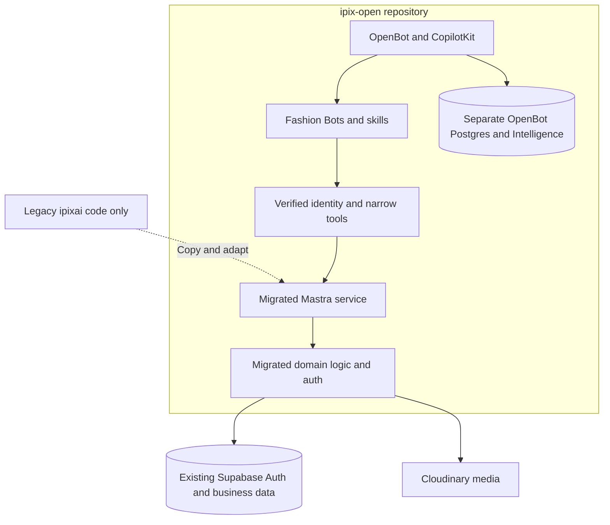
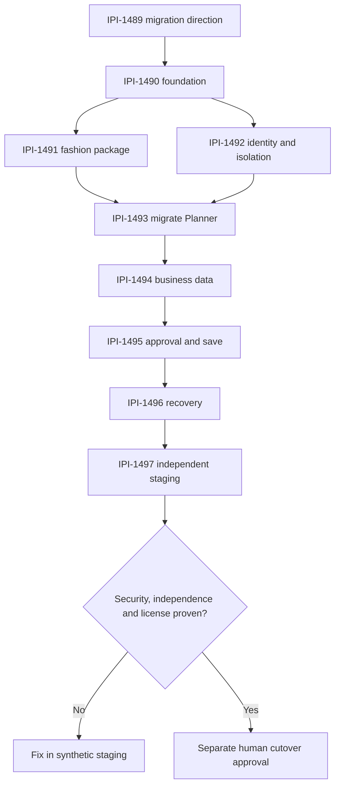

# iPix Open ADR 001 — Migrate iPix into OpenBot

**Status:** Owner-directed migration into ipix-open. Development and synthetic verification first; exact-head merge, live customer data and production cutover remain separate gates.
**Date:** 2026-11-23
**Task:** [IPI-1489](https://linear.app/amo100/issue/IPI-1489)
**Canonical application:** https://github.com/amoai-tech/ipix-open
**Legacy migration source only:** https://github.com/amoai-tech/ipixai
**Source baselines:** legacy 13bf2af385ebbe68a78c652daf5cffa3db95df24; OpenBot v1.1.2 8826a0fe3827b80c519b6b8a274e74efbaef7868. Revalidate before each migration.

## Decision

Build the new iPix application entirely in ipix-open. Copy and adapt proven iPix Mastra agents, tools, workflows, business logic, authorization, approval/save contracts and tests. **The legacy repository is source material, not a backend or runtime dependency.** No calls to the old Next.js application or its deployed APIs in the final architecture. Do not move the old UI wholesale or rebuild the packaged OpenBot server.

**Faster/better approach:** migrate one vertical slice first: a synthetic fashion producer requests a six-outfit shoot, sees a structured shot list and budget, then reviews and saves exactly one approved plan. Preserve existing Supabase identity and business data, Cloudinary media, Mastra contracts and tenancy. Keep OpenBot's own database/Intelligence separate. The new app and its Mastra service may be separate containers but are owned by the same repository.

The candidate destination is agent-mastra/src/mastra/ with migrated supporting domain modules and tests. Confirm the Bun/Node, dependency, alias and Docker compatibility first; if the existing harness cannot host the dependencies cleanly, use a dedicated iPix service inside ipix-open, not another repository. OpenBot v1.1.2 has a packaged backend, not editable server/src in this checkout.

## Migration sequence and implementation references

### Step 1 — Fashion configuration (IPI-1490 / IPI-1491)
**Destination:** examples/ipix/ and existing Compose configuration.
**Reference — ADAPT:** https://github.com/CopilotKit/OpenBot/tree/v1.1.2/examples/fintech → agents.yaml, skills.yaml, brand.yaml, channels.yaml, knowledge.yaml, model.yaml and catalog/.
- Use the tenant-package pattern; adapt for fashion and mount into the running backend.
- Do not copy demo identities, credentials, broad grants or irrelevant coworkers.
- Verify the package is loaded, UI chat/replay works, pinned image/config and restart are reproducible.
- Checkpoint: stop if package cannot be loaded.

### Step 2 — Migrate identity and one authorized read (IPI-1492)
**Destination:** iPix service within ipix-open; exact files after dependency inspection.
**Reference — ADAPT:** https://github.com/amoai-tech/ipixai/blob/13bf2af385ebbe68a78c652daf5cffa3db95df24/src/mastra/server-auth.ts → resolveMastraIdentity(), plannerMastraAuth, route allowlist. Copy the necessary auth dependency closure, not Next.js cookie-only assumptions. Use verified Supabase user JWT and live membership; never browser orgId, email, user_metadata, model output, service_role or shared service token as actor.
**Reference — ADAPT:** https://github.com/CopilotKit/OpenBot/blob/v1.1.2/docs/plugins/mcp-by-url.md and https://supabase.com/docs/guides/auth/oauth-server/mcp-authentication → per-user OAuth discovery, registration, PKCE and token security. Test compatibility and approved client/resource/audience first. Migrate a narrow list_my_brands operation using the existing domain reader; no broad management MCP in customer Bots. Check direct REST/RPC/storage bypass and revocation. OpenBot OAuth MCP and remote Mastra are distinct transports; identity forwarding must be separately proven.
- Verify two synthetic users, allowed own-brand read, forbidden foreign brand/thread/asset, invalid token, revoked membership and zero unauthorized effects.
- Checkpoint: stop before real data if per-user authorization or OpenBot workspace isolation fails.

### Step 3 — Migrate the real Planner (IPI-1493)
**Destination:** candidate agent-mastra/src/mastra/ and compatible domain modules/tests, all within ipix-open.
**Reference — ADAPT:** https://github.com/CopilotKit/OpenBot/blob/v1.1.2/agent-mastra/src/mastra/index.ts → native Mastra HTTP server and @ag-ui/mastra. Use native adapter if verified user identity is supported; otherwise test a bounded authenticated MCP operation calling the migrated Planner. Do not copy demo managed token as user identity or old custom AG-UI/SSE example.
**Reference — ADAPT:** https://github.com/amoai-tech/ipixai/tree/13bf2af385ebbe68a78c652daf5cffa3db95df24/src/mastra → agents/production-planner.ts, instructions, runtime.ts, planning/compose-shoot-plan/brand-intelligence tools, workflows, pg-store, thread-persistence, planner-tool-gate, run-control. Inspect dependency closure with Graphify and TypeScript. Copy pure logic; adapt runtime-specific auth and aliases; pin compatible packages and migrate corresponding tests. Legacy registry key default differs from agent ID production-planner; test discovery.
- Do not copy just src/mastra without its @/lib dependencies, whole legacy UI, node_modules, secrets or obsolete adapters. Do not assume old SDK versions compatible with Bun.
- Verify targeted tests, typecheck/build, authenticated discovery/stream, correct CopilotKit render, scoped memory, Stop/resume and synthetic user journey.
- Checkpoint: build and run from ipix-open alone, with no legacy checkout or running legacy service.

### Step 4 — Migrate business data and exact approval/save (IPI-1494 / IPI-1495)
**Destination:** same new iPix service and OpenBot visual catalog.
**Reference — ADAPT:** https://github.com/amoai-tech/ipixai/blob/13bf2af385ebbe68a78c652daf5cffa3db95df24/src/app/api/shoots/save/route.ts → strict approvalId, verified actor, saveApprovedShoot(), user-scoped Supabase. Port domain service and narrow supported endpoint; no runtime call to legacy route. Preserve exact artifact/revision/hash, role, ownership, idempotency and durable readback. Do not substitute generic Bot approval for domain approval or allow autonomous publishing, payments or deletes.
- Verify own-brand data, wrong-tenant/forged/stale approval denial, retries create exactly one canonical result, correct UI.
- Checkpoint: one human-approved result and zero unauthorized effects.

### Step 5 — Independent deployment and recovery (IPI-1496 / IPI-1497)
**Reference — REFERENCE ONLY:** https://github.com/CopilotKit/OpenBot/blob/v1.1.2/docs/configuration.md → private endpoint policy, tenant loader and multi-organization warning. Preserve isolated workspace DB/Intelligence, verify conversation/skills/files/computer/Vault/memory access. Do not enable multi-org as substitute for isolation or repoint OpenBot DATABASE_URL at Supabase.
- Verify clean ipix-open checkout, locked dependencies, independent image build, no legacy network/filesystem dependency, actual synthetic user journey, recovery and rollback.
- Checkpoint: no commercial cutover until security, runtime and license gates pass.

## Dependencies

## Release gates

| Gate | Status |
| --- | --- |
| New repo and selective migration direction | Owner-directed |
| Pinned OpenBot foundation | Partial prior proof; revalidate |
| Code/dependency migration and independent build | Pending |
| Per-user OAuth/remote Mastra identity and tenant isolation | Pending; hard stop |
| OpenBot workspace isolation | Pending; hard stop |
| Human approval and idempotent save | Pending |
| Commercial entitlement and production cutover | Not approved |

**Commercial gate:** https://github.com/CopilotKit/OpenBot/blob/v1.1.2/README.md and https://open.bot/pricing — confirm SaaS/embedding rights and separate Intelligence entitlement in writing; MIT source alone does not prove entitlement. Evaluate newer versions only with staging and rollback.

**Database gate:** preserve existing Supabase data and RLS. Coordinate IPI-1171 / IPI-1441 migration governance; no duplicate schema migration, parallel production writers or unauthorized data changes. Existing deployments remain untouched until a separately approved handover.

**Rollback:** retain legacy source and any existing deployment as a temporary rollback safeguard, not a required backend. Stop isolated new services and revoke staged grants on failed gates.

**Next:** IPI-1490/1491 and synthetic IPI-1492, then port the Planner under IPI-1493. Update IPI-1390 and downstream task references to the migration direction, without claiming implementation is complete.
