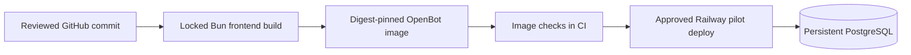

# iPix Open Railway pilot

Use the existing ipix-open-pilot service, not separately detected monorepo
workspaces. The image serves the checkout frontend and vendor API on one
origin, preserving OpenBot's init, embedded PostgreSQL and Chromium. It does
not rebuild the proprietary backend or enable a remote Planner.



## Step 1 — Build the reviewed source

**Destination:** Dockerfile.railway, Dockerfile.railway.dockerignore,
scripts/check-ipix-railway-image.sh and the existing CI build job.

**Reference — ADAPT:** https://github.com/CopilotKit/OpenBot/blob/v1.1.2/docs/deployment.md
→ published image and single-container architecture. Reuse the native init and
server; replace only the frontend assets and canonical tenant package. Do not
build unavailable server source, add demo agents or bake credentials into images.
Use the existing pinned Bun image from management-agent/Dockerfile and frozen
lockfile. The build context excludes environment files and local dependencies.

```sh
bash scripts/check-ipix-railway-image.sh
```

**Checkpoint:** CI builds the image and checks the native entrypoint, actual
production assets and read-only tenant files as the backend user. No database
or live API credentials are required. This is packaging proof, not auth or
licensed runtime certification.

## Step 2 — Connect the existing service after review

**Reference — ADAPT:** https://docs.railway.com/builds/dockerfiles
→ custom Dockerfile path. Use the root context and Dockerfile.railway.
Do not use Railpack auto-detection, Vite dev/preview or a separate management
agent. In the existing pilot service settings, connect amoai-tech/ipix-open
branch main only after merge approval and successful CI. Configure the Dockerfile
path, port 3001, healthcheck /health (180s timeout), one replica, and no sleeping.
Enable Wait for CI and verify which checks it waits for before enabling
automatic deployment. Preserve the service's variables and volume; do not
provision a duplicate database. The existing trial volume is only for synthetic
testing. Validate capacity and backups before increasing usage.

**Reference — REFERENCE ONLY:** https://github.com/CopilotKit/OpenBot/blob/v1.1.2/docs/configuration.md#authentication
→ authentication variables. Keep dedicated licensed Intelligence and model keys,
OAuth ID/secret, encryption key, Better Auth secret, exact HTTPS origin and
administrator email in Railway runtime variables. Restrict sign-in to the
approved iPix domain and keep single-user and multiple-organization modes off.
For embedded PostgreSQL, mount the persistent volume at /var/lib/postgresql
and set EMBEDDED_POSTGRES=on; do not set DATABASE_URL. Do not expose Chromium
or PostgreSQL ports. Never put secrets in Docker ARG, ENV, build context or Git.

**Checkpoint:** exact merged revision builds; Railway reports SUCCESS; /health
returns 200; signed-out requests are denied protected data; an authorized
operator signs in, verifies both fashion assistants and refresh/restart
persistence. No public customer onboarding or Supabase/Mastra integration until
the separately approved identity, isolation, licensing and recovery gates pass.
Stop if the backend digest and backend-images.env diverge; update both only in
an independently tested upgrade. Preserve the previous deployment and database
backup for recovery; never delete the volume or roll an incompatible database
back automatically.
